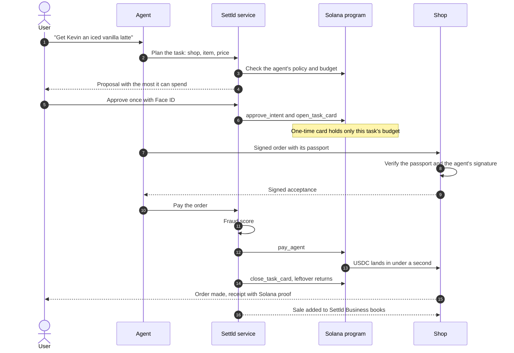
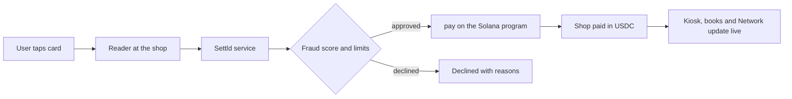

<div align="center">

<picture>
  <source media="(prefers-color-scheme: dark)" srcset="assets/logo-dark.png">
  
</picture>

**Ask. Approve. Settld.**

Secure stablecoin payment infrastructure for people, businesses and their agents. Built on Solana with payments settled in USDC.

4th place overall finish at HackATL

**Link to our presentation:** [Settld pitch deck](https://docs.google.com/presentation/d/1IOgjeyhBEvK8MEgcmAMK93eLKR5jfDscNVoV-gwj_uY/edit?usp=sharing)

**Contributors:** James Rivera, Kevin Chen, Cyrus Ruggeri, Theo Yu, Barsa Majidi

</div>

## The problem

Software agents can now plan, shop and act for people, but there is no safe way to let them pay. Hand an agent a card and it can spend anything. Approve every purchase by hand and the agent is pointless. Shops have the opposite problem: they cannot tell a trusted agent from a bot.

Card rails make it worse. Merchants wait days for their money, pay 2 to 3 percent, and find out about fraud weeks later.

## What Settld does

Settld sits between an agent and money. An agent can buy things for its owner inside limits it cannot break, and the shop can verify exactly which agent is paying and who it works for.

**Identify the agent**
- **Know Your Agent.** Every agent carries a passport signed by Settld. The shop checks it before serving.
- **Digital ID.** The passport names the agent, its owner, its signing key and the hash of its rules.
- **Signatures.** The agent signs every order, the shop signs what it accepts and makes, and Settld signs the passport.
- **Proof of History.** Every step is hashed into a chain and anchored on Solana, so the record cannot be rewritten.

**Give it autonomy**
- **Human in the loop.** The owner approves a task once with Face ID, then the agent finishes it alone. Purchases above a set amount ask first, and any agent can be frozen instantly.

**Keep it safe**
- **Policy as code.** Budgets, per-purchase caps, allowed shops, hours and purchases per hour live in the Solana program. The agent cannot raise its own limits.
- **Just-in-time cards.** Each approved task gets a one-time card holding only that task's budget. It closes when the job is done and returns what is left.

## How a payment flows

### Agent purchase



### Card tap at the counter



## What is in this repo

| Part | Path | What it does |
|---|---|---|
| Solana program | `programs/settld` | Cards, agents, spending policy, one-time task cards, approvals and USDC settlement. 22 instructions. |
| Payment service | `services/auth` | FastAPI service: card taps, fraud scoring, agents, shop fulfillment, books and the live event feed. |
| Chain sidecar | `services/chain` | Node service that builds and sends program transactions. |
| Fraud model | `ml` | LightGBM models trained on card fraud data and on live tap features. |
| Web app | `dashboard` | Next.js: shop kiosk, Settld Business books, the Network view and the web account. |
| iOS app | `ios/Settld` | SwiftUI: account, Settld card, agents, approvals with Face ID, NFC card writing. |
| Scripts | `scripts` | Setup, seeding, stress test and a command line tap. |
| Tests | `tests` | Program tests against a local validator. |

## Architecture

```
  NFC card ──► reader (ACR1252U) ──► tap_listener.py ─┐
                                                       │
  iOS app ─────────────────────────────────────────────┤
                                                       ▼
  Kiosk / Business / Network (Next.js) ◄──── WebSocket ─── Payment service (FastAPI :8000)
                                                       │      ├─ fraud model (LightGBM, in process)
  iMessage ──► /api/inbox ─────────────────────────────┤      ├─ agents and shop fulfillment
                                                       │      └─ books and audit export
                                                       ▼
                                          Chain sidecar (Node :8787)
                                                       │
                                                       ▼
                                     Settld program on Solana (devnet)
                                     Config · Card · Merchant · Agent · Intent
```

A tap or an agent order reaches the payment service, which scores it, checks policy, and asks the sidecar to send the program instruction. The program enforces the limits and moves USDC from the card to the shop. Every result is broadcast to the web pages over a WebSocket with its Solana signature.

## Quickstart

### Prerequisites

- Solana CLI 4.1.x and Anchor 1.2.0 (`avm install 1.2.0 && avm use 1.2.0`)
- Node 22
- Python 3.12+
- Xcode and XcodeGen for the iOS app (optional)
- An ACS ACR1252U reader and NTAG215 cards for card taps (optional)

### Setup

```bash
scripts/setup.sh
cp .env.example .env
```

Fill in `.env`. The main values:

| Key | Purpose |
|---|---|
| `ANCHOR_PROVIDER_URL` | Solana RPC (devnet or `http://127.0.0.1:8899`) |
| `ANCHOR_WALLET` | Issuer keypair path |
| `SETTLE_MINT` | 6-decimal settlement mint |
| `ADMIN_TOKEN`, `TAP_TOKEN`, `SHOP_TOKEN`, `INBOX_TOKEN` | Shared secrets for admin, reader, shop and inbox calls |
| `ANTHROPIC_API_KEY`, `AGENT_MODEL` | Language model used by the agents |
| `CHAIN_URL` | Sidecar address, default `http://127.0.0.1:8787` |
| `MODEL_PATH` | Fraud model file |

### Deploy and seed

```bash
anchor build
anchor deploy
npm run seed
```

### Run

Four processes:

```bash
npm run sidecar
```

```bash
CHAIN_URL=http://127.0.0.1:8787 .venv/bin/uvicorn services.auth.main:app --host 0.0.0.0 --port 8000
```

```bash
cd dashboard && npm run dev
```

```bash
MERCHANT_ID=6 .venv/bin/python services/auth/tap_listener.py
```

Then open:

- `http://localhost:3000/kiosk?merchant=6` for the shop kiosk
- `http://localhost:3000/business?merchant=6` for the shop's books
- `http://localhost:3000/network` for the live network view

### iOS app

```bash
cd ios/Settld && xcodegen && open Settld.xcodeproj
```

Set the service address in the app's settings, then build to a device. NFC card writing needs a physical iPhone.

### Hosting

The web app builds to a static site (`npm run build` writes `dashboard/out`) and is served from Cloudflare Pages. A Pages function under `dashboard/functions/api` forwards `/api` calls to the payment service, whose address is stored in the `UPSTREAM` secret.

## Hardware

- **Reader:** ACS ACR1252U over USB. It shows up as a PC/SC reader, so no drivers are needed on macOS.
- **Cards:** NTAG215 cards and NTAG213 stickers. Every card is keyed by its 7-byte UID.
- **Writing a card:** the iOS app reads a blank card's UID over NFC, links it to the account and writes the card number onto it. At the counter, the listener reads the UID with `FF CA 00 00 00` and posts the tap to the service.

Check the reader:

```bash
.venv/bin/python -c "from smartcard.System import readers; print(readers())"
```

## Fraud model

Trained on the ULB credit card fraud dataset (284,807 rows, 492 fraud) with a time-ordered split.

| Metric | Value |
|---|---|
| ROC-AUC | 0.9864 |
| PR-AUC | 0.7904 |
| Single score | 0.038 ms |

A second model is trained on simulated taps using the features available at the counter: amount, shop category, hour, card velocity, new card, the same card at two shops within 60 seconds, and distance from the usual shop. Every payment is scored before money moves, and a stopped payment comes with plain reasons.

Retrain (download `creditcard.csv` from the Kaggle ULB dataset into `ml/data/` first):

```bash
.venv/bin/python ml/train.py
.venv/bin/python ml/live_train.py
```

Full results are in `ml/REPORT.md`.

## Solana program

Program ID (devnet): `BexCXNjkZWSdAoHMGXMEh421eFVbWJ1cUgAkS1iMG5BM`

Accounts: `Config`, `Card`, `Merchant`, `Agent`, `Intent`.

| Group | Instructions |
|---|---|
| Setup | `init_config`, `register_card`, `set_card_owner`, `register_merchant`, `set_merchant_agent_policy` |
| Cards | `deposit`, `pay`, `withdraw`, `set_card_status`, `authorize_batch`, `settle` |
| Agents | `register_agent`, `set_agent_policy`, `fund_agent`, `clawback`, `set_agent_frozen`, `freeze_all`, `pay_agent` |
| Tasks | `approve_intent`, `close_intent`, `open_task_card`, `close_task_card` |

Run the program tests:

```bash
anchor test
```

Explorer links use `https://explorer.solana.com/tx/<signature>?cluster=devnet`.

## Throughput

- Public devnet allows about 4 transactions per second per IP, so live taps and agent orders go to devnet and the stress test runs on a local validator.
- `authorize_batch` packs many authorizations into one transaction for volume.
- Transactions are sent at `processed` commitment with a cached blockhash and a small priority fee, then upgraded to `confirmed` in the background.

```bash
solana-test-validator
ANCHOR_PROVIDER_URL=http://127.0.0.1:8899 RATE=500 npx ts-node scripts/stress.ts
```

## Business model

- 2% per purchase, paid by the shop. Free for people and their agents.
- $99 a month for Settld Business, the audit-ready books.

## License

MIT
